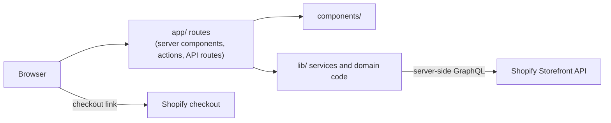

# Lion Leather

[](https://github.com/SyedHaider037/lion-leather/actions/workflows/ci.yml)
[](LICENSE)
[](https://nextjs.org)

A headless e-commerce storefront for premium leather footwear and accessories, built on Next.js and the Shopify Storefront API.

> **Work in progress.** "Lion Leather" is a working title and may change. The project is under active development, not production-ready, and not a finished product.

## Live demo

[https://lion-leather.vercel.app](https://lion-leather.vercel.app)

## Screenshots

_Screenshots will be added here._

## Features

- **Collections**: category pages for wallets, belts, footwear and bags, with sorting and price filters. A collection that does not exist in the store shows an empty state.
- **Product pages**: image gallery with zoom, variant selection, add to cart, related products, a size guide link for footwear, and structured data (JSON-LD) for search engines.
- **Cart**: a Shopify cart whose id lives in an httpOnly cookie. Quantity changes and removal work from the cart page and a cart drawer. Checkout happens on Shopify.
- **Search**: live product search backed by an API route.
- **Newsletter**: saves the email as a Shopify customer with marketing consent.
- **Size guide**: a shoe size guide page.
- **Content pages**: about, craft, leather care, FAQ, shipping and returns, privacy policy, terms of service, contact and track order.
- **SEO**: `robots.txt`, a sitemap built from the store's products and collections, and generated Open Graph and Twitter images.
- **Health route**: `/api/health/shopify` returns `{"ok":true}` when the Storefront API answers, or `{"ok":false}` with a 503 when it does not. It exposes no shop details.
- **Spam protection**: the contact and newsletter forms use a hidden honeypot field and a minimum fill time, with no third-party service.
- **Error handling**: custom error, global error and not-found pages. A missing product or page returns a real 404.

## Tech stack

- [Next.js](https://nextjs.org) 16 (App Router) and React 19
- TypeScript
- Tailwind CSS 4
- Shopify Storefront API (GraphQL), called from the server
- [zod](https://zod.dev) for environment and input validation
- Vitest for unit tests, ESLint, and Prettier

## Architecture

The code is split into three layers:

1. **`app/`**: routes, layouts, server actions and API routes.
2. **`components/`**: UI, grouped by area.
3. **`lib/`**: everything that is not UI. This includes the Shopify client and queries, cart session handling, environment validation, form spam checks, the logger and shared constants.



**Data flow.** Pages are server components. They ask `lib/shopify` for data, which sends a GraphQL request to the Storefront API from the server and returns typed results. The access token is never sent to the browser. Responses are cached for 60 seconds by default, and the cart uses `no-store` so it is always current. Mutations such as add to cart and newsletter sign-up are server actions.

**Why no UI library or global store.** Most of the site is server-rendered, so there is little client state to share. The cart lives in Shopify and is read on the server, and the few interactive parts (gallery, drawer, search box) keep their own local state. That keeps the client bundle small and avoids a state library.

## Project structure

```
app/                 Routes (App Router)
  api/               Cart, cart count, search and health routes
  cart/              Cart page and its server actions
  collections/       Collection list and collection pages
  products/          Product pages
  ...                Content pages, robots, sitemap, error pages
components/          UI by area
  cart/  home/  layout/  product/  search/  ui/
lib/                 Non-UI code
  shopify/           Storefront client, queries and fragments
  cart/              Cart session and cart API helpers
  forms/             Spam checks
  newsletter/        Newsletter server action
  hooks/  utils/     Shared hooks and helpers
  constants.ts  env.ts  logger.ts  site-config.ts  size-guides.ts
tests/               Vitest unit tests
public/              Static assets
.github/             CI workflow and Dependabot settings
```

## Getting started

Requires Node.js 20.9 or newer (a requirement of Next.js 16). Running the tests needs Node.js 22.12 or newer (a requirement of Vitest 5), and Node.js 22 is recommended.

You also need a Shopify store with the Storefront API enabled and a Storefront API access token.

```bash
npm install
cp .env.example .env.local   # then fill in your own values
npm run dev
```

The dev server runs on http://localhost:3000.

## Environment variables

Copy `.env.example` to `.env.local` and fill in your own values. Never commit `.env.local`. The values below are placeholders.

| Variable                           | Required | Where it is used                   | Example (placeholder)          |
| ---------------------------------- | -------- | ---------------------------------- | ------------------------------ |
| `SHOPIFY_STORE_DOMAIN`             | yes      | Server-only                        | `your-store.myshopify.com`     |
| `SHOPIFY_STOREFRONT_ACCESS_TOKEN`  | yes      | Server-only                        | `your-storefront-access-token` |
| `SHOPIFY_STOREFRONT_API_VERSION`   | no       | Server-only (default `2025-01`)    | `2025-01`                      |
| `NEXT_PUBLIC_SHOPIFY_STORE_DOMAIN` | no       | Public (checkout links)            | `your-store.myshopify.com`     |
| `NEXT_PUBLIC_SITE_URL`             | no       | Public (metadata, robots, sitemap) | `https://example.com`          |
| `NEXT_PUBLIC_WHATSAPP_NUMBER`      | no       | Public (links and labels)          | `+92 300 0000000`              |
| `NEXT_PUBLIC_CONTACT_EMAIL`        | no       | Public (footer, privacy policy)    | `hello@example.com`            |

Variables starting with `NEXT_PUBLIC_` are included in the browser bundle, so only put values there that are safe to show. If the two public contact values are not set, the site shows placeholders.

## Scripts

| Command                | What it does                            |
| ---------------------- | --------------------------------------- |
| `npm run dev`          | Start the development server            |
| `npm run build`        | Production build                        |
| `npm run start`        | Serve the production build              |
| `npm run lint`         | Run ESLint                              |
| `npm run typecheck`    | Type-check with `tsc --noEmit`          |
| `npm test`             | Run the unit tests (Vitest)             |
| `npm run format`       | Format all files with Prettier          |
| `npm run format:check` | Check formatting without changing files |

## Testing and CI

The unit tests cover cart input checks, the size guide mapping, the spam check, environment and site URL handling, price formatting, the contact config and the logger. They run without a network.

GitHub Actions runs on every push and pull request to `main`, in this order: install with `npm ci`, formatting check, type-check, lint, unit tests, an `npm audit` of production dependencies (high severity), and a production build. The build uses placeholder Shopify values and no secrets. The workflow token is read-only, a newer run cancels an older one on the same branch, and Dependabot proposes npm and Actions updates weekly.

## Deployment on Vercel

1. Import the repository into Vercel.
2. In **Settings → Environment Variables**, add the variables from the table above for both **Production** and **Preview**. At minimum set `SHOPIFY_STORE_DOMAIN` and `SHOPIFY_STOREFRONT_ACCESS_TOKEN`, and set your own `NEXT_PUBLIC_SITE_URL`, `NEXT_PUBLIC_WHATSAPP_NUMBER` and `NEXT_PUBLIC_CONTACT_EMAIL`.
3. Turn on deployment protection for previews so that preview URLs are not public.
4. In Shopify, turn the store password off before launch. Customers cannot reach checkout while the storefront password is on.

## Security notes

- Only the public Storefront API token is used. There is no Admin API token anywhere in the code.
- Secrets live only in environment variables. `.env.local` is git-ignored, and `.env.example` holds placeholders only. Nothing secret is stored in the repository.
- The Storefront token is read on the server and sent from the server.
- The cart id is stored in an httpOnly cookie.
- The server logger prints one JSON line per message and hides values under keys such as token, authorization, email, phone, password and cookie. Stack traces are left out in production.
- Responses carry basic security headers (`X-Content-Type-Options`, `Referrer-Policy`, `X-Frame-Options`, `Permissions-Policy`).

## Known limitations and roadmap

- The contact form opens a prefilled WhatsApp message for the visitor to send; it does not send email. Real email delivery still needs a provider.
- "Track order" opens a pre-filled WhatsApp message rather than looking up an order.
- Site copy, policies and brand details are placeholders pending real business content.
- Automated tests are unit tests only; there are no end-to-end tests yet.
- Collection pages expect the Shopify collection handles `wallets`, `belts`, `footwear` and `bags`.

Next steps: email delivery for the contact form, end-to-end tests, a custom domain, analytics and the final brand name.

## License

The code is released under the [MIT License](LICENSE).

The brand name, logo, product photos and shop copy are **not** covered by that licence. All rights to them are reserved, and they may not be reused.

## Author

Syed Haider · [github.com/SyedHaider037](https://github.com/SyedHaider037)
